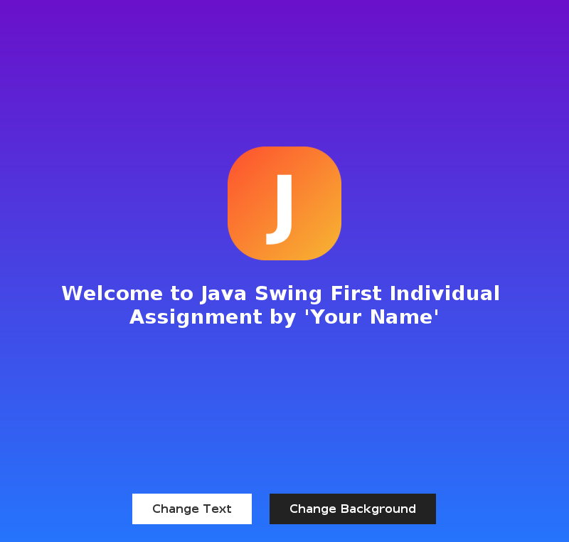
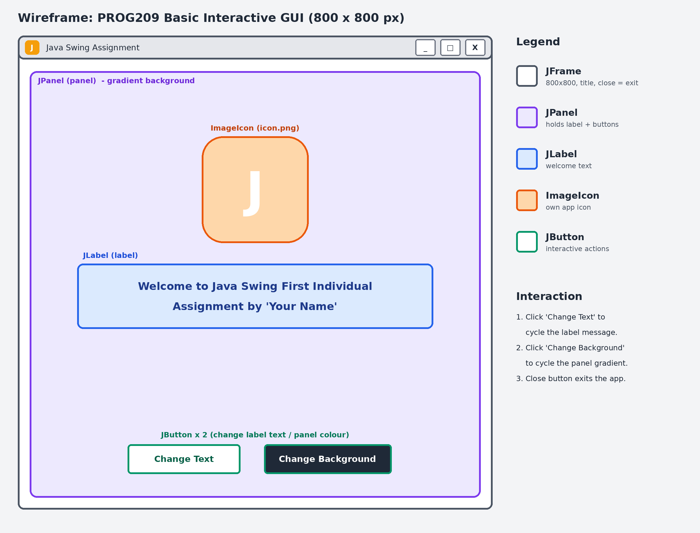

# PROG209 – Event Driven Programming: Basic Interactive GUI

**Module:** PROG209 Event Driven Programming  
**Assignment:** Individual Assignment 1 – Basic Interactive GUI (10%)  
**University:** Limkokwing University of Creative Technology, Sierra Leone  
**Student:** Your Name  
**Lecturer:** Amandus Benjamin Coker

## About the project

A colourful Java Swing desktop application that demonstrates the core building
blocks of a GUI program: a `JFrame`, a `JPanel`, a `JLabel` and an `ImageIcon`,
together with **inheritance** and **constructors**. Two buttons add interactivity:
one changes the text of the label and the other changes the background colour of the panel.



## Features

- `JFrame` titled **Java Swing Assignment**, sized **800 x 800** pixels, which closes the program when the close button is clicked.
- `JPanel` with a custom gradient background (`GradientPanel` **extends** `JPanel`).
- `JLabel` showing the welcome message with the application icon.
- Own application icon (`icon.png`) loaded with `ImageIcon` and used for the window icon and the label.
- **Change Text** button – cycles through four different messages.
- **Change Background** button – cycles through five gradient colour themes.

## Concepts demonstrated

| Concept | Where in the code |
|---|---|
| Inheritance | `GradientPanel extends JPanel` (overrides `paintComponent`) |
| Constructors | `SwingAssignment()` builds the GUI; `GradientPanel(Color, Color)` sets up the panel |
| JFrame | `frame` – title, size, close operation |
| JPanel | `panel` – holds the label and buttons |
| JLabel | `label` – welcome text and icon |
| ImageIcon | `loadIcon()` – loads `icon.png` (falls back to a drawn icon) |
| Event handling | `ActionListener` lambdas on both buttons |

## Wireframe

The wireframe was designed for Figma (800 x 800 frame). `wireframe.svg` can be
dragged straight into Figma to edit it.



## Project structure

```
SwingAssignment/
├── SwingAssignment.java   # source code
├── icon.png               # application icon
├── wireframe.png          # wireframe image
├── wireframe.svg          # editable wireframe (import into Figma)
├── screenshot.png         # screenshot of the running app
└── README.md
```

## How to run

Requirements: **JDK 11 or later** (tested with JDK 21).

**Command line** (run from the project folder so that `icon.png` is found):

```bash
javac SwingAssignment.java
java SwingAssignment
```

**IntelliJ IDEA / VS Code:** open the folder, set the working directory to the
project folder (where `icon.png` is) and run `SwingAssignment`.

> Before running, open `SwingAssignment.java` and change `STUDENT_NAME` to your own name.

## Author

Your Name – Limkokwing University, Sierra Leone
